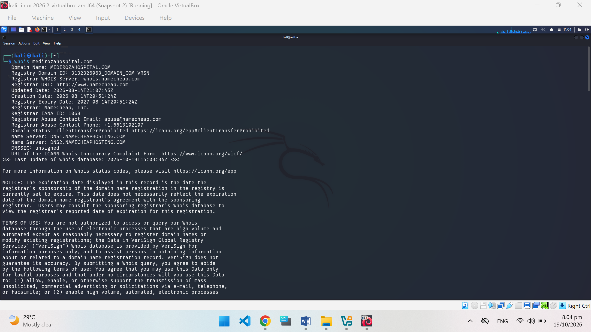
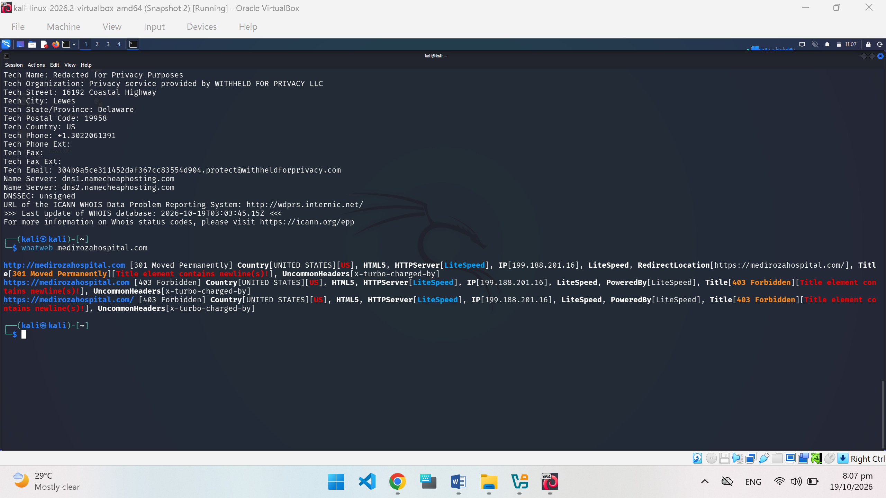
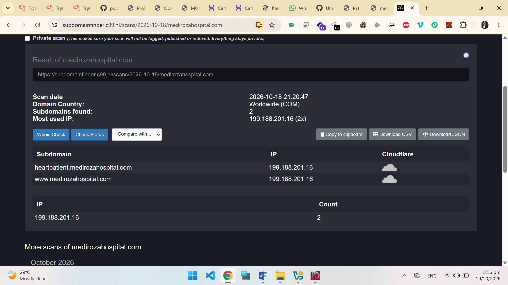
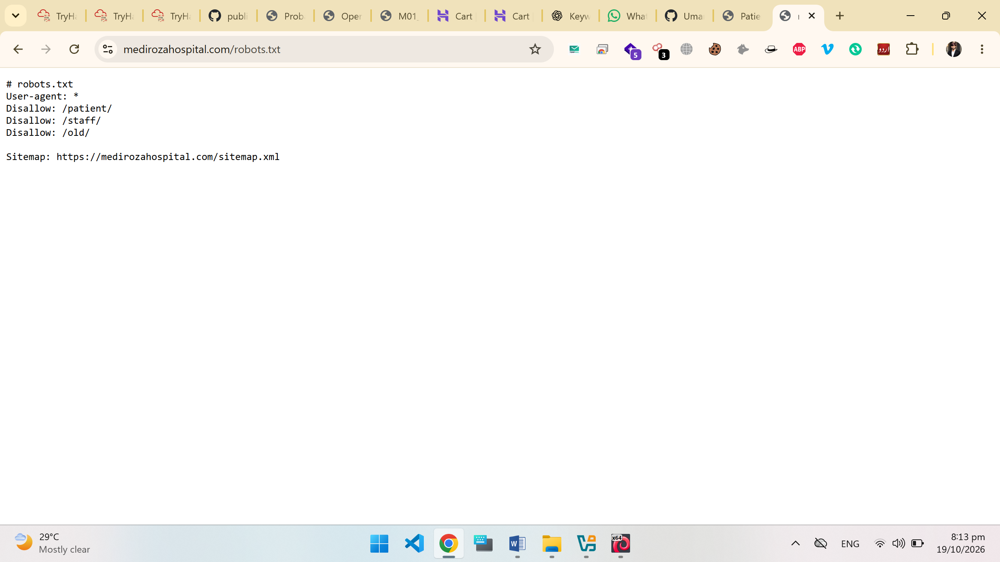
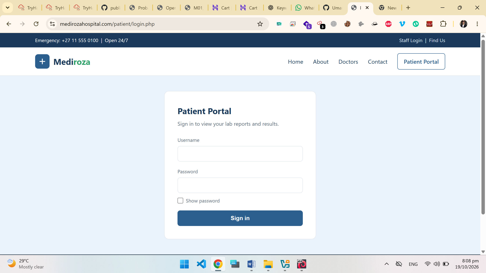
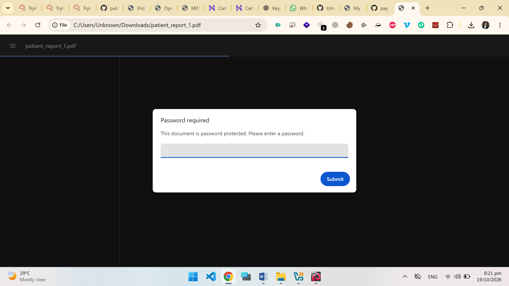
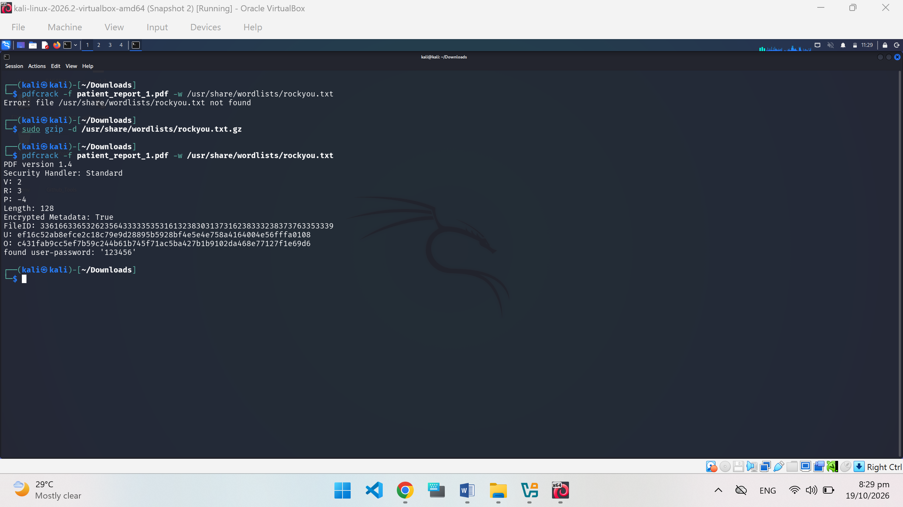

# Mediroza Hospital — Web Security Assessment

**Prepared by Muhammad Ahmad**  
Evidence-based penetration testing report · GitHub edition · 

> This report documents the supplied assessment screenshots. It does not represent a new live test. The reference repository describes an educational Networkwalks exercise; written authorization for Muhammad Ahmad's individual assessment was not included in the evidence. No authorization or affiliation is asserted here.

## Report navigation

- [Assessment overview](#assessment-overview)
- [Scope and evidence boundaries](#scope-and-evidence-boundaries)
- [Results at a glance](#results-at-a-glance)
- [Reconnaissance observations](#reconnaissance-observations)
- [Finding F-01 — Suspected SQL injection authentication bypass](#finding-f-01--suspected-sql-injection-authentication-bypass)
- [Finding F-02 — Weak password on a patient PDF](#finding-f-02--weak-password-on-a-patient-pdf)
- [Observation O-01 — Server fingerprint disclosure](#observation-o-01--server-fingerprint-disclosure)
- [Combined impact](#combined-impact)
- [Remediation roadmap](#remediation-roadmap)
- [Retest acceptance criteria](#retest-acceptance-criteria)
- [Conclusion](#conclusion)
- [Evidence index](evidence/README.md)
- [GitHub upload guide](docs/GITHUB-UPLOAD.md)

## Assessment overview

The supplied material records reconnaissance of `medirozahospital.com`, access to its patient portal, and examination of a downloaded password-protected PDF. The most important result is the combination of apparent login bypass and successful recovery of a weak document password. Together, these observations indicate a route from the login interface to readable medical-report content.

The portal-access finding is strongly suggested by an SQL-style value displayed in a browser password-save dialog while the protected portal is open. However, screenshots do not contain the original HTTP request, response, session history, or backend code. The injection mechanism is therefore reported as **suspected**, not independently verified. In contrast, the PDF recovery terminal explicitly records successful recovery, and a separate screenshot shows the opened report.

This edition uses a findings-first structure, separates observations from vulnerabilities, and connects each conclusion to Muhammad Ahmad's own supplied evidence. Findings from the example report have not been imported as if they were demonstrated here.

| Report field | Value |
| --- | --- |
| Author | Muhammad Ahmad |
| Subject | Mediroza Hospital patient portal and report protection |
| Primary hostname in evidence | `medirozahospital.com` |
| Evidence capture date | Desktop screenshots display 19 October 2026 |
| Report preparation date | 19 October 2026 |
| Source package | `myreport.zip` — 10 PNG screenshots |
| Assessment basis | Offline review of user-provided artifacts |
| Verification status | No independent live retest performed |
| Edition | Public-facing GitHub report with selected evidence |

## Scope and evidence boundaries

### Components represented

| Component | Evidence available | Coverage limit |
| --- | --- | --- |
| Domain registration | WHOIS terminal output | Historical screenshot, not a current registry check |
| Web infrastructure | WhatWeb output | No full port scan, TLS review, or server configuration |
| Hostname discovery | Third-party subdomain scan page | Listed hostnames were not independently validated |
| Crawl directives | Browser view of `/robots.txt` | Listed paths do not establish exposed data |
| Patient login | `/patient/login.php` screenshot | No captured request or source code |
| Patient portal | `/patient/portal.php` screenshots | Session and account identity are not established |
| Exported report | PDF prompt, recovery output, opened document | Only one PDF recovery is demonstrated |

The screenshots show a Windows desktop, Chrome, and a Kali Linux virtual machine running in Oracle VirtualBox. Visible tools include WHOIS, WhatWeb, a third-party subdomain discovery service, and `pdfcrack` with a dictionary file. No claim is made that tools appearing only in the example report, such as Gobuster, were used in this assessment.

### Evidence interpretation

1. **Observed:** directly visible in an uploaded screenshot.
2. **Inferred:** a plausible explanation of those observations, requiring further confirmation.
3. **Not demonstrated:** absent from the submitted evidence and excluded from confirmed findings.

The archive contains screenshots rather than raw HTTP logs, database extracts, source code, or original PDF bytes. Screenshot names provide useful labels but are not independent proof of a vulnerability. Local and virtual-machine clocks differ, so a precise minute-by-minute attack timeline is not asserted.

The reference repository includes a database backup leak, staff records, shareholder records, and a verbose database error. None is demonstrated by this submission. They are intentionally excluded. The reference also reports a different WHOIS result; the supplied screenshot here shows an actual registration record.

## Results at a glance

Severity labels below are qualitative triage judgments for the depicted scenario. They are not calculated CVSS scores. The material does not support a reliable quantitative rating or a claim about all users and all records.

| ID | Result | Priority | Evidence confidence |
| --- | --- | --- | --- |
| F-01 | Suspected SQL injection authentication bypass | High, provisional | Portal access visible; injection causality requires confirmation |
| F-02 | Weak password on one exported patient PDF | High | Recovery output and opened-document screenshot |
| O-01 | Server fingerprint disclosure | Informational | LiteSpeed and descriptive headers visible |
| R-01 | Application paths advertised in robots.txt | Context only | Paths visible; no access-control failure proven |

## Reconnaissance observations

### Registration information

The WHOIS screenshot displays `MEDIROZAHOSPITAL.COM`, NameCheap as registrar, and the nameservers `DNS1.NAMECHEAPHOSTING.COM` and `DNS2.NAMECHEAPHOSTING.COM`. The record includes a creation date of 14 August 2026 and an expiry date of 14 August 2027. These values describe the submitted capture only.

Registration information supports asset context. It does not prove who operates the application or who authorized testing. The screenshot also displays DNSSEC as unsigned; no DNS attack or exploitability is established by that field alone.



### Web technology fingerprint

WhatWeb output associates the target with IP address `199.188.201.16`, reports LiteSpeed, and shows a redirect from HTTP to HTTPS. Subsequent captured responses include `403 Forbidden`. The output also exposes `x-turbo-charged-by` and a LiteSpeed-powered banner.

A forbidden response from a tool request does not demonstrate that the whole application is inaccessible. Other supplied browser screenshots show application pages. The evidence does not identify the reason for this difference.



### Hostname discovery

The third-party scan page lists two names, both associated with `199.188.201.16`:

| Hostname | Address shown |
| --- | --- |
| `heartpatient.medirozahospital.com` | `199.188.201.16` |
| `www.medirozahospital.com` | `199.188.201.16` |

The displayed service scan date is 18 October 2026; the desktop capture date is 19 October 2026. These are candidate assets, not proof that both hosts were reachable, vulnerable, or within an approved testing scope.



### Crawl directives

The captured `/robots.txt` contains:

```text
User-agent: *
Disallow: /patient/
Disallow: /staff/
Disallow: /old/

Sitemap: https://medirozahospital.com/sitemap.xml
```

This reveals application path names. A robots directive asks compliant crawlers not to visit a path; it does not enforce authentication or authorization. The `/old/` entry alone does **not** establish that a database backup is accessible.



## Finding F-01 — Suspected SQL injection authentication bypass

| Attribute | Assessment |
| --- | --- |
| Affected interface | `/patient/login.php` |
| Observed destination | `/patient/portal.php` |
| Provisional severity | High |
| Confidence | Moderate for injection causality; high for portal visibility |
| Potential weakness | Improper handling of SQL input during authentication |
| Remediation status | Not verified |

### Evidence and observed behavior

The first screenshot shows a patient sign-in page with username and password fields. A later screenshot shows the protected-looking “My lab reports” page and a browser password-save prompt. That prompt displays the same SQL-style input in both fields: an administrator-style username followed by a quote and SQL comment characters. A separate screenshot shows three downloadable report entries and a logout control.

These observations support Muhammad Ahmad's supplied description of a SQL injection login bypass. They do not show the login request or prove that this particular submission created the session. An already authenticated session cannot be excluded from screenshots alone. No exact payload execution procedure is needed to understand or remediate the reported issue.



The two portal screenshots contain patient identifiers, and one also includes a personal browser-account email. This public package records their technical observations in the evidence index instead of reproducing those images.

### Security impact

If injection is confirmed, an unauthenticated user could obtain application access without valid credentials. The visible consequence is access to report listings and download controls. This threatens confidentiality of patient information.

The submitted evidence does not establish database modification, administrator privileges, operating-system access, full database extraction, or access to every patient account. Those impacts must not be assumed from the portal screenshot.

### Likely cause and corrective action

A possible cause is SQL query construction that mixes untrusted input with query syntax. Backend code was not supplied, so this remains a hypothesis.

The application owner should parameterize database queries, retrieve the intended user record safely, and verify a stored password hash using the platform's password-verification function. Passwords should not be checked through plaintext SQL comparisons. Regenerate the session identifier after successful login and enforce authorization independently on portal and download routes. Ensure that each document request is checked against the authenticated user's permitted records.

Existing sessions should be assessed for invalidation if unauthorized access is confirmed. Application logs can help determine affected requests and records; the screenshots cannot determine the extent of any prior access.

## Finding F-02 — Weak password on a patient PDF

| Attribute | Assessment |
| --- | --- |
| Affected artifact | `patient_report_1.pdf` |
| Severity | High in the depicted medical-report context |
| Confidence | High for this single document |
| Prerequisite | Possession of the encrypted PDF |
| Observed outcome | Password recovered; document content subsequently visible |
| Remediation status | Not verified |

### Evidence and observed behavior

The browser initially requests a password when opening the downloaded PDF. Terminal evidence shows an initial dictionary-file-not-found error, followed by dictionary preparation and a successful recovery attempt. The tool explicitly reports a recovered six-digit numeric password. A separate screenshot shows the PDF open with patient identity fields and laboratory results.

The successful terminal result is visible below. The password is not repeated in the narrative; it remains visible in the supplied technical evidence. The opened medical-report screenshot is excluded from this public package because it contains personal and clinical details.





### Interpretation and limits

The result demonstrates weak password protection for one supplied report. It does not prove that every exported document uses the same password. The terminal also displays PDF security-handler and encryption metadata, but encryption length alone does not offset a readily guessed password. No exact cracking duration or testing throughput is supported by the screenshot.

Offline password guessing occurs against a file already obtained. Login rate limits on the website would not stop guessing against a local copy. This is why secure download authorization and strong document protection are separate requirements.

### Security impact

An individual who obtains the PDF can potentially recover its password and read its contents. In the depicted case, the opened-document screenshot confirms exposure of patient fields and laboratory results. This can undermine confidentiality even when the PDF initially appears protected.

### Corrective action

Use authenticated, individually authorized document delivery as the primary control. If password-protected exports are necessary, assign strong, unique randomly generated secrets and communicate them separately. Avoid shared, predictable, or reused passwords. Review other exports to determine the actual extent of reuse; it is not established here.

Evaluate whether affected documents need reissuance through a secure delivery process. Replacing a hosted PDF cannot revoke copies that have already been downloaded. Retest representative exports and verify both download permissions and protection of the exported files.

## Observation O-01 — Server fingerprint disclosure

WhatWeb identifies LiteSpeed and descriptive response headers. This is an informational observation because it aids software identification but does not, by itself, demonstrate an exploitable weakness. An exact server version is not established in the displayed output.

Remove unnecessary identifying headers where practical, while prioritizing supported software, secure configuration, and timely updates. Hiding a banner is not a substitute for fixing authentication or document protection.

## Combined impact

The evidence suggests a sequence in which the patient login is bypassed, report downloads become available, and one exported report's password is recovered. The opened report supports the confidentiality consequence. The initial bypass mechanism still requires independent verification.

These are two separate control layers: access to the report and protection after download. Fixing only the PDF password leaves the suspected authentication flaw unresolved. Fixing only login does not strengthen weakly protected copies already distributed.

There is no evidence here of persistence, malware, privilege escalation, destructive actions, or changes to clinical records. The report makes no availability or integrity compromise claim.

## Remediation roadmap

The following order is a proposed response plan, not a record of completed work.

| Priority | Action | Suggested owner | Completion evidence |
| --- | --- | --- | --- |
| 1 | Verify the login issue in an authorized isolated environment; contain the affected route if confirmed | Application owner | Captured test results and containment record |
| 1 | Parameterize login queries and use secure password-hash verification | Backend developer | Code review and authentication tests |
| 1 | Enforce per-user authorization on portal and downloads | Backend developer | Cross-account access tests fail safely |
| 2 | Assess session exposure and review relevant access logs | Security / operations | Documented assessment and session decision |
| 2 | Replace predictable export passwords and review secret reuse | Application / document owner | Export-policy review and sample validation |
| 2 | Adopt authenticated delivery and suitable document-sharing controls | Product / security owner | Approved workflow and access tests |
| 3 | Remove unnecessary response banners | Infrastructure owner | Header review |
| 3 | Review public path exposure and placement of backups | Operations | Configuration and storage review; no leak assumed |

## Retest acceptance criteria

- A clean unauthenticated session cannot reach the patient portal or download a protected report.
- Invalid credentials and SQL-like input receive a generic failure without creating an authenticated session or exposing a database error.
- A valid user can sign in, and their session identifier is regenerated on authentication.
- User A cannot obtain User B's report by changing an identifier or reusing a download URL.
- Login code uses bound parameters and a secure password-verification function.
- Newly exported documents do not use the demonstrated weak secret or predictable shared values; generation and delivery policies are reviewed.
- All findings receive recorded retest evidence before being marked resolved.

A single failed dictionary attempt is not sufficient proof of strong document security. Verification should also inspect password generation, uniqueness, access control, and delivery behavior.

## Conclusion

Muhammad Ahmad's submitted evidence documents patient portal visibility and successful recovery of one report's weak PDF password. The screenshots strongly suggest an SQL injection authentication bypass, while the exact mechanism requires request-level verification. The main corrective priorities are secure authentication, per-report authorization, and stronger export protection.

This repository preserves the limits of the evidence: it does not claim a database backup leak, universal patient access, or a completed remediation. Its purpose is to present the submitted work clearly, with traceable evidence and practical next steps.

## Sources and attribution

- **Primary evidence:** the ten screenshots supplied in `myreport.zip`.
- **Structural reference:** `NETWORKWALKS-UMAR-B083-WK4-MEDIROZA-PENETRATION-TEST-main.zip`, supplied by the user. Used as an example of report organization, not as proof of this assessment's results.
- **Author:** Muhammad Ahmad.

The prose and organization in this report are newly prepared. No screenshots, staff datasets, shareholder tables, or video from the reference repository are included. See the [evidence index](evidence/README.md) for source mappings, hashes, and omitted-image summaries.
